# Portal Pressure Simulator: Design Blueprint (cut down, 11 Nov 2026)

> **Status.** This was the original build spec (v0.1, October 2026). It is kept because the code comments cite its section numbers
> (for example "blueprint §7.2", "§9.3", "P7"), so every heading is still here. What still holds is written out in full:
> **§1 Design principles**, **§7 the physics engine**, **§10 presets, interventions and event detectors**, **§12 the acceptance tests**
> (automated in `tests/acceptance.test.js`) and **§13.4 the worker protocol**. The interface sections (§3 to §6, §8, §9, §11, §13 and §14 to §16)
> described the first build and are now one or two lines that say how the app works today. For the current app see the
> [README](../README.md), the [CHANGELOG](../CHANGELOG.md) and `AGENTS.md`.
>
> **Scope:** education only. The app is not a clinical decision tool and says so.

---

## Table of contents

0. [Vision in one paragraph](#0-vision-in-one-paragraph)
1. [Design principles](#1-design-principles)
2. [Audience & learning objectives](#2-audience--learning-objectives)
3. [Information architecture & modes](#3-information-architecture--modes)
4. [Screen layout (desktop / tablet / phone)](#4-screen-layout)
5. [Visual language & design tokens](#5-visual-language--design-tokens)
6. [The anatomical stage (the centrepiece)](#6-the-anatomical-stage)
7. [Physics engine: the hemodynamic model](#7-physics-engine)
8. [Interactions, tools & direct manipulation](#8-interactions-tools--direct-manipulation)
9. [Readouts, instruments & charts](#9-readouts-instruments--charts)
10. [Scenarios, interventions & the case engine](#10-scenarios-interventions--the-case-engine)
11. [Pedagogy layer](#11-pedagogy-layer)
12. [Physiological acceptance tests](#12-physiological-acceptance-tests)
13. [Technical architecture](#13-technical-architecture)
14. [Accessibility, performance, safety copy](#14-accessibility-performance-safety-copy)
15. [Roadmap (phased build)](#15-roadmap)
16. [Open questions](#16-open-questions)

---

## 0. Vision in one paragraph

A **living anatomical model of the portal circulation** that learners can poke, pinch, clot,
stent, and bleed. Resistance goes up and blood **finds another way**: collateral veins open,
esophageal varices **swell and thin until they rupture**, the portal vein **reverses direction**,
the spleen enlarges, and ascites fills the abdomen. None of this is scripted. It all **emerges
from one physically consistent pressure–flow model**. Every number on screen can be
traced back to a cause with a "Why?" button. It should feel like a flight simulator for
hepatology and look like a modern medical atlas that happens to be alive.

---

## 1. Design principles

| # | Principle | What it means in practice |
|---|-----------|---------------------------|
| P1 | **Emergent, not scripted** | Flow reversal, varix inflation, and ascites come out of the equations. Never add `if (cirrhosis) showVarices()`. The UI only *reports* what the model computes. |
| P2 | **One model, many lenses** | The anatomy view, circuit view, charts, Doppler, endoscopy, and dashboard all read the same state. None of them owns data. |
| P3 | **Direct manipulation first** | Every parameter you can change with a slider you can also change *on the anatomy* (pinch a vessel, paint fibrosis, drag a catheter). Sliders are the precise fallback, not the main interface. |
| P4 | **Predict → Observe → Explain** | A deck can ask a question before the slide answers it (the question card and the case card's question). The "Why?" trace explains the result in plain causal language. |
| P5 | **Clinically faithful numbers** | Pressures in mmHg, flows in L/min or mL/min, and clinical thresholds (HVPG 5 / 10 / 12 / 20, PPG < 12 after TIPS) match the literature within stated tolerances (§12). |
| P6 | **Calm by default, dramatic on demand** | Healthy state is quiet and elegant. Pathology gets progressively more visual: swelling, color shift, pulsing, warnings. A bleed is loud. |
| P7 | **Never color alone** | Every color encoding also has shape, motion, text, or pattern. |
| P8 | **60 fps on a mid-range phone** | Physics runs in a worker. Rendering is budgeted. Motion respects `prefers-reduced-motion`. |

---

## 2. Audience & learning objectives

**Primary users:** medical students (preclinical physiology and clinical GI), internal-medicine and GI
residents, and nurses and APPs in hepatology. **Secondary:** educators projecting in lectures, and curious patients
(with simplified copy).

**By the end, a learner can:**

1. Explain portal pressure as **P = Q × R** and say why both *forward flow* (splanchnic
   vasodilation, hyperdynamic circulation) and *backward resistance* (fibrosis) raise it.
2. Classify portal hypertension as **prehepatic, presinusoidal, sinusoidal, postsinusoidal, or
   posthepatic** from the measured WHVP, FHVP, HVPG, PV pressure, and ascites protein.
3. Explain why **HVPG is normal in presinusoidal disease and in right heart failure**, for
   different reasons.
4. Name the major **portosystemic collaterals** and predict which one enlarges for a given
   obstruction (e.g. splenic vein thrombosis leads to isolated gastric varices).
5. Use **Laplace's law** to explain why large, thin-walled varices under high transmural pressure
   rupture.
6. Predict the hemodynamic effect of **NSBBs, carvedilol, terlipressin/octreotide, EVL, TIPS,
   surgical shunts, BRTO, balloon tamponade, paracentesis, and transfusion**, including their
   unintended consequences (post-TIPS encephalopathy, rising pressure after BRTO, rebleeding
   after over-transfusion).
7. Explain the causes of **hepatofugal flow** and of **reversed intrahepatic portal flow after TIPS**.
8. Explain the **hepatic arterial buffer response**, and why liver perfusion doesn't simply fall
   in proportion to portal flow.

---

## 3. Information architecture & modes

The app has two modes, **Present** (the decks) and **Patients** (free exploration with the controls). Lessons, Cases and Compare modes were removed. Parameter changes keep an undo and redo history (`src/ui/store.js`). All views share one stage and one engine.

## 4. Screen layout

### 4.1 Desktop (≥ 1280 px): "cockpit"

Mac and iPad on its side: the figure fills the stage, the teaching card and the data card sit over it, the controls panel (`src/ui/inspector.js`) opens at the right, the instruments card (`dock.js`) at the bottom. See `docs/stage-map.md`.

### 4.2 Tablet (768–1279 px)

The tablet layout follows the desktop one; an upright iPad uses the phone layout.

### 4.3 Phone (< 768 px), portrait-first

A phone uses a stacked layout: the figure on top, the cards in a sheet under it, a thumb dock at the bottom. The cards are fixed-size; nothing tucks away (removed 7 Nov 2026).

### 4.4 Projector / lecture mode

Presenting is the Present mode: projector-first decks (`docs/deck-authoring-guide.md`), a presenter view in a second window (key P), and a laser and pen (key L).

## 5. Visual language & design tokens

### 5.1 Aesthetic direction

The look is an atlas plate: muted tissue tones so the vessels lead, Source Serif 4 titles over an Inter body.

### 5.2 Color tokens (define on `:root`, re-map for dark)

Colour tokens are defined once in `src/ui/theme-tokens.js` and printed to `styles/tokens.css` (`npm run gen:theme`). There are six looks: Light (Linen), Soft (Oat), Dark, Navy, Black and System. Every text token reads at 4.5:1 or better on every surface it sits on, in every look (`tests/token-contrast.test.js`).

### 5.3 The pressure colormap (venous and portal vessels only)

A **perceptually uniform sequential map** interpolated in **OKLCH**, with lightness decreasing
steadily as pressure rises so it still reads in grayscale (OKLab lightness .93, .80, .66, .61, .48, .34 at the stops;
before 18 Oct 12 and 20 mmHg shared .55). Anchor stops:

| mmHg | Meaning | Color (approx.) |
|------|---------|-----------------|
| 0 | RA / collapse | `#B8D5ED` pale ice |
| 5 | normal portal / HVPG upper normal | `#85B6E9` sky |
| 10 | **CSPH** threshold | `#6787E8` cornflower |
| 12 | **variceal bleeding risk climbs** (not a cut-off) | `#925CDD` violet |
| 20 | high-risk bleeding | `#A4216E` carmine |
| 30+ | extreme | `#680C2F` deep wine |

(The stops are the Light (Linen) look's `ramp-pressure` in `src/ui/theme-tokens.js`; the dark looks lift the dark ends. `src/ui/colormap.js` interpolates them in OKLab.)

- The key on the figure is a slim bar with ticks at the cut-offs and names the colouring.
- Arteries aren't on this scale (they'd saturate at 90 mmHg). They're drawn in `--artery`, thinner and at lower opacity, so
  they read as "supply lines."
- **Other colourings** (the lens, set on a slide or from the colour menu): pressure (default), change from healthy, congestion, pressure drop, flow volume, velocity, flow direction, oxygen, blood origin and first pass. `docs/deck-authoring-guide.md` section 5.2 lists them.

### 5.4 Typography

Inter for the interface, Source Serif 4 for titles, JetBrains Mono for code-like values; tabular figures where numbers align. The figure's text is fixed at 100% (no text-size setting).

### 5.5 Motion

All durations and curves live in `src/ui/motion.js`. With Reduce Motion a change is instant, except the camera glide and the Anatomy to Circuit change, which run 300 ms (`docs/ACCESSIBILITY.md`).

### 5.6 Iconography

Line icons (Lucide style, 1.5 px stroke). Custom glyphs you'll need: `pinch`, `clot`, `stent`,
`band`, `balloon`, `catheter`, `probe`, `doppler`, `endoscope`, `reversed-flow ⟲`, `varix`.

---

## 6. The anatomical stage

### 6.1 Canvas & orientation

The anatomy plate has the logical space 1400 by 1000 units (`src/ui/anatomy.js`); the named camera regions are in `src/ui/decks.js` (`REGIONS`). The plate is drawn on the GPU.

### 6.2 Vessel rendering

Vessels are drawn on the GPU by the Tube renderer (`docs/tube-renderer.md`): each vessel is a half tube with smoothed joints, cel-shaded with a dark outline, with the moving blood drawn in the tube's own shader. The lumen is coloured by the lens (pressure by default, §5.3); the wall thins as the vessel distends (tube law, §7.3).

- **Blood speed** follows mean velocity (Q/A) on a compressed scale; **density** follows |Q|; **direction** follows the sign of Q. When a vessel's flow reverses, the blood decelerates, stops and turns round over about 600 ms (it never teleports), and chevrons point the new way, so reversal has a shape cue as well as a colour (P7).
- Near zero flow (stasis, below 9 cm/s in the portal vein) the blood thins to faint smoke.
- A station whose vessel's flow has reversed carries ⟲ after its value, in the reversed-flow orange.
- Vessel labels are one style: outlined text with no box.

### 6.3 Collaterals & varices (the "hidden network")

Collaterals C1a to C9 and the drawn shunts are listed in `docs/deck-authoring-guide.md` section 8.5. A red-wale overlay on the esophageal varices under high wall stress is still a wish (`docs/recommendations/visual-style.md`).

### 6.4 Semantic zoom levels

A dive goes from the body plate into the **liver lobule** (portal triads at the corners, sinusoids running to the central vein, the space of Disse with lymph, zones 1 to 3 and the three resistance sites) and on into the **sinusoid wall**. The **varix** is shown in cross-section by the wall instrument (radius r, wall thickness w, wall stress σ = ΔP·r / w) and by the endoscopy scope. A deck slide shows one of these scales by diving into it (`docs/deck-authoring-guide.md` 5.11).

### 6.5 Circuit view

The circuit view is a transit map with 45 degree routing and zone bands; the change from the anatomy to the circuit morphs over 1.3 s.

## 7. Physics engine

### 7.1 Modeling approach

A **0-D lumped-parameter network** (the electrical analogue) with **nonlinear elements** and
**two timescales**:

- **Fast (hemodynamic) timescale, milliseconds to minutes:** pressures, flows, vessel areas, reflexes.
- **Slow (remodeling/disease) timescale, days to months:** collateral growth, varix
  enlargement, splenomegaly, splanchnic vasodilation, ascites accumulation, fibrosis progression.

Conventions:

- State: node pressures **P** (mmHg), node volumes **V** (mL), edge flows **Q** (mL/s internally,
  displayed as L/min).
- Resistance **R** is in PRU (mmHg·s/mL). Display it in Wood units (mmHg·min/L) if the user asks.
  1 WU = 0.06 PRU.
- The flow sign convention is **defined per edge** in its *physiological direction*
  (e.g. PV → liver is positive). **Negative flow means reversed**, and that's the only thing the UI uses to detect reversal.
- **The portal system has no valves.** Every portal and collateral edge is bidirectional. That's
  deliberate, and Lesson 1 teaches it. Only the heart valves and systemic limb veins have diode behavior.

### 7.2 Network topology (v1)

```mermaid
flowchart LR
  AO((Aorta<br/>MAP)) -->|SMA+arterioles| INT[Intestinal bed]
  AO -->|splenic a.| SPL[Spleen]
  AO -->|L gastric a.| STO[Stomach bed]
  AO -->|IMA| COL[Colon/rectal bed]
  AO -->|hepatic a. ⚙HABR| SIN_R & SIN_L
  AO -->|rest of body SVR| SYS[Systemic veins]

  INT --> SMV
  COL --> IMV
  IMV --> SV
  SPL --> SV
  STO --> LGV
  SMV --> CONF((Confluence))
  SV --> CONF
  LGV --> CONF
  CONF --> PV --> RPV & LPV
  RPV -->|R_pre| SIN_R[Sinusoid inlet R] -->|R_sin| CV_R[Central venules R]
  LPV -->|R_pre| SIN_L[Sinusoid inlet L] -->|R_sin| CV_L[Central venules L]
  SIN_R <-->|inter-lobar| SIN_L
  SIN_R -->|stagnant column| W[(Wedge compartment)]
  CV_R <-->|inter-sinusoidal leak| W
  W -->|closed by balloon| RHV
  CV_R -->|R_post| RHV & MHV
  CV_L -->|R_post| LHV & MHV
  CV_R -->|caudate veins| IVCs
  RHV & MHV & LHV --> IVCs[Suprahepatic IVC]
  IVCs --> RA((RA))

  SYS --> IVCi[Infrahepatic IVC] --> IVCs
  LRV[L renal v.] --> IVCi
  RRV[R renal v.] --> IVCi
  ILI[Iliac vv.] --> IVCi
  AZY[Azygos] --> SVC --> RA
  RA -->|Frank–Starling pump| AO

  %% collaterals (dotted = recruitable)
  LGV -.C1 esophageal varices.-> VAR[(Esoph. varix)] -.-> AZY
  SV -.C2 short gastrics.-> GV[(Fundal varix)]
  GV -.-> LGV
  GV -.C5 gastrorenal.-> LRV
  SV -.C6 splenorenal.-> LRV
  LPV -.C3 paraumbilical.-> EPI[Epigastric vv.] -.-> ILI
  EPI -.-> SVC
  IMV -.C4 rectal.-> ILI
  SMV -.C7 Retzius.-> LRV
  CONF -.C8 periportal.-> RPV

  %% interventions (off by default)
  RPV -. TIPS .-> RHV
  PV -. portocaval .-> IVCi
  SV -. distal splenorenal .-> LRV
  SMV -. mesocaval .-> IVCi
  AO -. arterioportal shunt .-> RPV & LPV
```



About 35 nodes and 55 edges. The **topology is data** (JSON, §13.3). Adding a vessel shouldn't need
engine code.

**Why each lobe has three resistance segments:** you need the pre / sinusoidal / post split to
reproduce the **HVPG vs. PV pressure dissociation** that separates presinusoidal from sinusoidal
disease. The node order is **PV branch → R_pre → sinusoid inlet (hepatic artery joins here) →
R_sin → central venules → R_post → hepatic vein**.

**The wedge compartment `W`** is a small side compartment that stands in for the sinusoids drained
by the wedged hepatic-vein branch. It connects to the **sinusoid inlet** through a "stagnant
column" conductance G_col, and to the neighbouring **central venules** through an
**inter-sinusoidal leak** conductance G_leak. When the balloon closes W's outflow, W settles to
`WHVP ≈ (G_col·P_inlet + G_leak·P_CV) / (G_col + G_leak)`:

- **Normal liver** (G_col : G_leak ≈ 4 : 1): WHVP sits slightly below PV pressure.
- **Sinusoidal cirrhosis** (cirrhosis shrinks G_leak toward 0): WHVP ≈ P_inlet ≈ PV pressure.
- **Presinusoidal block**: P_inlet is downstream of the block, so WHVP stays normal while PV is high.
- **Postsinusoidal disease or right heart failure**: both P_inlet and P_CV rise. In heart failure FHVP rises equally, so HVPG stays normal.

### 7.3 Element library

| Element | Equation | Used for |
|---------|----------|----------|
| **Linear resistor** | Q = (P₁ − P₂)/R, with R = 8μL/(πr⁴) · k_shape | Arterioles, capillary beds, stents |
| **Collapsible vessel** (tube law) | A = A₀ · f(P_tm) with P_tm = P − P_ext. Distends when P_tm > 0 (compliant, then stiffening), and collapses when P_tm < 0. Resistance R ∝ A₀²/A². | All veins, portal vessels, collaterals, IVC, hepatic veins |
| **Starling resistor** | If P_downstream < P_ext < P_upstream, then Q = (P_up − P_ext)/R (waterfall) | Hepatic veins at the diaphragm, IVC under tense ascites |
| **Nonlinear compliance** | V = V₀ + C·P for P ≥ 0, stiffening above P_knee: C_eff = C·exp(−(P−P_knee)/P_s) | Every venous node. **Unstressed volume V₀** matters for bleeding and transfusion. |
| **Inertance** (optional, pulsatile mode) | L · dQ/dt = ΔP − R·Q | IVC, hepatic veins, and PV to carry the RA waveform |
| **Diode (valve)** | Q = max(0, ΔP)/R, with a tiny leak | Heart valves, lower-limb veins only |
| **Recruitable collateral** | A tube-law vessel whose baseline diameter d is a **slow state** (§7.6). Initially d ≈ d_min, so R is huge. | C1–C8 |
| **Varix compartment** | A collapsible node with external pressure = esophageal luminal pressure (≈ 0 to −5 mmHg, inspiration-dependent) and its own wall thickness w (thins as it remodels). Computes **wall stress σ = (P_var − P_lumen)·r / w**. | Esophageal varix, fundal varix |
| **Starling filter** | J_v = K_f[(P_c − P_i) − σ(π_c − π_i)] | Sinusoids → space of Disse (σ ≈ 0.1 in normal fenestrated sinusoids, rising to about 0.6 with capillarization), and splanchnic capillaries (σ ≈ 0.9) |
| **Lymph drain** | Q_lymph = min(J_v, Q_lymph_max), where Q_lymph_max slowly adapts upward | The overflow goes to the **peritoneal compartment** as ascites |
| **Heart** | CO = CO_max · contractility · sigmoid((P_RA − P₀)/k) (Frank–Starling), limited by HR. The pump moves volume from RA to AO. | Closes the circulation |
| **Reflex controllers** | First-order lag toward a target (τ ~ 5–30 s) | Baroreflex (MAP → SVR, HR, contractility, splanchnic tone) and **HABR** (below) |

**Hepatic arterial buffer response (HABR):**
hepatic arterial conductance is
`G_HA = G_HA0 · (1 + k_HABR · clamp((Q_PV,ref − Q_PV,in)/Q_PV,ref, 0, 1))` with τ ≈ 10 s and k_HABR ≈ 1.5.
Its capacity is reduced in advanced cirrhosis. It partly protects total liver perfusion when portal
flow falls (after TIPS, or with PVT). The liver-perfusion donut shows it.

**Arterioportal shunting:** an edge from the hepatic artery to the portal venules whose conductance
scales with cirrhosis severity. It's the mechanism that lets **the PV trunk reverse flow**
(arterial blood enters the portal branches and leaves retrograde through the PV into collaterals).
Without it, PV reversal can't emerge.

**External pressures:** every abdominal vein uses `P_ext = IAP` (intra-abdominal pressure).
Every thoracic vein uses `P_ext = P_pleural`, which follows a respiratory waveform (−5 mmHg inspiration,
−2 mmHg expiration, adjustable). The **Valsalva** button raises both to about +30 mmHg for 10 s.
IAP comes from ascites volume through an abdominal compliance curve (normal 5–7 mmHg; ≥ 12 is
intra-abdominal hypertension). **Ascites raises variceal and IVC pressure, and paracentesis
lowers it.** This comes out of the model.

**Blood viscosity:** μ depends on hematocrit. Hemorrhage plus crystalloid lowers Hct, which lowers μ and
slightly lowers R. It's minor, but it's there for completeness.

### 7.4 Collateral recruitment & remodeling (slow states)

For each recruitable collateral *i*, diameter **dᵢ** evolves on the disease clock:

```
dd/dt = k_shear · (τ_wall/τ_set − 1) · d          // flow-mediated outward remodeling
      + k_press · max(0, P_tm − P_open)            // pressure-driven dilation / angiogenesis (VEGF)
      − k_regress · (d − d_min)                    // regression when unloaded
clamp d ∈ [d_min, d_max]
τ_wall = 4μQ/(π r³)
```

- The **positive feedback** (more flow means more shear, so a bigger vessel, so more flow) is realistic.
  It's bounded by d_max and the pressure term.
- **P_open** is about 10 mmHg of portal-to-systemic gradient. That's why collaterals and varices
  appear around **HVPG ≥ 10 (CSPH)**, which is one of the acceptance tests.
- Collaterals have **hysteresis**: after TIPS they regress slowly (weeks), which matches how varices shrink
  after TIPS.

### 7.5 Varix model & rupture

- Radius r comes from the tube law, on top of a **slow baseline radius** r₀ that grows with chronic
  pressure (remodeling). Wall thickness w shrinks as r₀ grows (conservation of wall mass:
  w·r₀ ≈ const).
- **Wall stress:** `σ = (P_var − P_lumen) · r / w`.
- **Grade display:** small is < 5 mm, large is ≥ 5 mm. Red wale signs appear when T/T_crit > 0.7.
- **Rupture is a stochastic hazard** evaluated each simulated second:
  `h = h₀ · max(0, T/T_crit − 1)^n` (n ≈ 3). Calibrate so that
  **rupture essentially never happens when HVPG < 12**. An **"Deterministic rupture"** option in
  settings makes lessons reproducible by rupturing exactly when T > T_crit.
- **Once ruptured:** a new edge `VAR → GI lumen (sink)` opens with a resistance scaled to the tear size.
  Blood volume drains, **MAP and portal pressure fall** (tamponade physiology), and the baroreflex
  kicks in, helped by the venous reservoir and a volume afferent (`RESERVOIR` in engine.js), so the vital signs follow
  the ATLS hemorrhage classes. Bleeding can stop spontaneously if P_var falls below a clotting threshold. It can
  **rebleed** if pressure recovers, for example from **over-transfusion**. That's a key teaching loop.

### 7.6 Two clocks

| Clock | dt | What's integrated |
|-------|----|-------------------|
| **Hemodynamic** | 1 ms (pulsatile) / 10 ms (mean mode) | Pressures, flows, areas, reflexes, bleeding, respiration |
| **Disease** | 1 simulated day per step | d of collaterals, varix r₀ and w, spleen volume, splanchnic arteriolar tone (NO-mediated vasodilation as a function of chronic portal pressure, producing the hyperdynamic circulation), plasma volume expansion, lymph capacity, ascites volume, optional fibrosis progression |

In **Disease mode**, each day step first solves the fast system to a **quasi-steady state**
(Newton iteration, §7.7), then updates the slow states. The UI shows a calendar ("Month 7")
and a **fast-forward** control: +1 week, +1 month, +6 months, and "until next event."

### 7.7 Numerics

- The system is **stiff** (large compliances next to tiny resistances). Use **implicit
  (backward) Euler** with one Picard/Newton linearization per step. Each step solves
  `(C/dt + G(P)) · Pⁿ⁺¹ = C/dt · Pⁿ + s`, a sparse ~35×35 system. Dense LU is fine
  at this size.
- Run it in a **Web Worker** at a fixed timestep, decoupled from rendering. The worker posts
  a snapshot (P, Q, A, slow states, events) about ten times a second (`docs/PERFORMANCE.md`), and the main thread eases between them.
- Use a **steady-state solver** (Newton on G(P)·P = s with volume conservation) for presets,
  Disease-mode steps, and instant "jump to equilibrium" (the **⟲ Settle** button).
- **Conservation check:** total blood volume must be conserved to 0.01% per minute when there's no
  bleeding or infusion. Assert this in development builds.
- **Determinism:** seed the RNG (for rupture hazard) per scenario. The same URL gives the same run.

### 7.8 Baseline parameters & calibration targets

These are starting values. **Tune them with an automated calibration script** (§13.5) that fits the
free parameters to the targets.

**Targets (healthy adult at rest, 70 kg):**

| Quantity | Target | Tolerance |
|----------|--------|-----------|
| MAP | 93 mmHg | ±5 |
| CO | 5.0 L/min | ±0.3 |
| RA (mean) | 3 mmHg | ±2 |
| IVC (suprahepatic) | 3.5 mmHg | ±2 |
| FHVP | 4 mmHg | ±2 |
| WHVP | 7 mmHg | ±2 |
| **HVPG** | **3 mmHg** | 1–5 |
| PV pressure | 7.5 mmHg | 5–10 |
| Total hepatic blood flow | 1.5 L/min (~25–30% of CO) | ±0.2 |
| PV flow | 1.1 L/min (~70–75% of hepatic) | ±0.15 |
| HA flow | 0.4 L/min | ±0.1 |
| SMV flow / SV flow | ~0.7 / ~0.4 L/min | ±0.1 |
| PV mean velocity | 15–20 cm/s (d ≈ 12 mm) | within 12–25 |
| PV pulsatility index | < 0.3 | — |
| Collateral flow (total) | < 2% of portal flow | — |
| Hepatic lymph | ~0.5 mL/min | order of magnitude |
| IAP | 5 mmHg | ±2 |
| Spleen length | 11 cm | < 13 |

**Starting resistances (PRU, mmHg·s/mL)** that roughly produce the targets above:

| Segment | R₀ | Notes |
|---------|----|-------|
| SMA + intestinal arterioles | ~6.9 | (93 − 12) / 11.7 mL/s |
| Intestinal venules → SMV | ~0.26 | |
| SMV → confluence | ~0.13 | |
| Splenic artery + pulp | ~12 | |
| SV → confluence | ~0.2 | |
| PV trunk + branches | ~0.02 | |
| Presinusoidal: portal venules to sinusoid inlet (combined) | ~0.02 | "R_pre", carries portal flow only |
| Sinusoidal: sinusoid inlet to central venules (combined) | ~0.09 | "R_sin", carries portal + arterial flow |
| Postsinusoidal: central venules to hepatic veins (combined) | ~0.03 | "R_post" |
| Wedge compartment G_col : G_leak | 4 : 1 (normal) | Cirrhosis drives G_leak toward 0 |
| Hepatic veins → IVC | ~0.02 | |
| Hepatic artery (incl. arterioles) | ~12.8 | modulated by HABR |
| Collaterals, closed (d_min) | ≥ 300 | |
| Collaterals, fully open (d_max) | 0.1–0.5 | C6 splenorenal can reach ~0.1 |
| TIPS 8 mm / 10 mm | ~0.10 / ~0.04 | Poiseuille from d⁴ plus stent length ~8 cm; calibrate so a 10 mm TIPS in HVPG-20 cirrhosis gives PPG ≈ 8–11 |

---

## 8. Interactions, tools & direct manipulation

### 8.1 Tool rail

There is no tool rail. The controls are the inspector panel, the command palette and direct taps on the figure.

### 8.2 Hover and selection feedback

Hover and selection light a vessel in its station colour. In a talk the figure is read-only.

### 8.3 The HVPG measurement procedure (a flagship interaction)

(Today the catheter is under Measure › HVPG, and the decks play it step by step with the slide field `cath`; there is no tool rail.)

1. Choose the **Catheter** tool. A sheath appears in the IVC (via the jugular approach, drawn coming
   down from the top).
2. **Drag** the catheter tip into the RHV, MHV, or LHV. Snapping and resistance-to-drag feedback make
   it feel like steering.
3. The readout shows **FHVP** live with a mini pressure trace.
4. Press **Inflate balloon**. In the model, the outflow edge of that vein's **wedge compartment
   `W`** (§7.2) closes. Flow in that column stops, and its pressure **equilibrates toward the
   sinusoid-inlet pressure**, pulled slightly down by the inter-sinusoidal leak. The trace
   rises and plateaus over ~20–40 s of simulated time, like the real tracing. (One wedge
   compartment per hepatic vein: RHV, MHV, LHV.)
5. Record **WHVP**. **HVPG = WHVP − FHVP** is computed and stamped onto the history timeline.
6. Teaching payoff: repeat in **presinusoidal** disease (schistosomiasis preset). The PV is 20
   mmHg but **WHVP is normal**, so HVPG is normal. Repeat in **right heart failure**: FHVP and WHVP are both
   high, but HVPG is normal.

The HVPG tile always shows the model's HVPG (the "Always show HVPG" setting was removed on 11 Nov 2026); the catheter tracing shows how it is measured.

### 8.4 Global parameter panel (inspector with nothing selected)

Parameters are grouped in collapsible sections. Each slider has: a label, a live value with units,
the **physiological range shaded** on the track, a reset-to-baseline dot, and an info icon.

- **Liver:** R_pre, R_sin, R_post (or one "Liver resistance" slider plus a **site triangle**: a
  2-D barycentric picker for pre / sinusoidal / post), Cirrhosis severity macro (0–100%, which drives all
  the cirrhosis-linked parameters together), HABR strength, arterioportal shunting.
- **Inflow:** Splanchnic arteriolar tone (vasodilation ⇄ constriction), MAP, CO/contractility, HR.
- **Outflow:** Hepatic vein patency (each vein), IVC stenosis (supra/infra), RA pressure
  (via contractility / tricuspid regurgitation), pericardial constraint.
- **Volume:** Total blood volume, Hct, plasma albumin (oncotic pressure).
- **Environment:** Respiration (on/off, depth), IAP override, posture (supine/upright: an optional
  hydrostatic term).
- **Simulation:** Pulsatile ⇄ mean mode, speed, RNG seed, deterministic rupture.

A **"Cirrhosis severity" macro slider** is the primary control for novices. The individual
resistances are under "Advanced ▸".

### 8.5 Keyboard map (desktop)

Keyboard use is listed in the in-app Guide (Help › Keyboard shortcuts). The presenter keys are in `docs/deck-authoring-guide.md` section 12.

## 9. Readouts, instruments & charts

### 9.1 Clinical strip (always visible)

The tiles and their cut-offs are in `src/ui/table-marks.js` (`RATE`, `SCALE`, `CUT`) and in `docs/deck-authoring-guide.md` section 8.6. Pressure colours and cut-offs live once in `src/engine/pressure-cuts.js`: HVPG amber 5, red 10; PPG amber 6, red 12.

### 9.2 Dock charts

The signature chart is the Gut to heart pressure profile (`charts.js`, `tool-profile.js`), with the healthy line dashed and a red block where the resistance is. Other cards (flows, curve, causes, trace, Doppler) are listed in the deck authoring guide, section 7.2.

### 9.3 "Why?" causal trace

Clicking any metric opens a small panel with:

- A **plain-language sentence** built from templates and the model's sensitivities, e.g.
  *"Portal pressure is 18.4 mmHg (▲ 10.9 from baseline) mainly because sinusoidal resistance rose
  ×5.2 (contributes +9.8). Increased splanchnic inflow adds +1.6. Collateral decompression
  offsets −0.5."*
- A **waterfall mini-chart** of those contributions.
- **Formula peek:** the live equation with numbers, `ΔP = Q × R = 0.92 L/min × 12.1 WU = 11.1 mmHg`.
- **Highlight on stage:** the elements that contribute pulse briefly.

Implementation: run a local sensitivity analysis (finite differences on the steady-state
solver, one parameter at a time, relative to the baseline snapshot, with a Shapley-style ordering
for fairness) in the worker when the user asks. Cache the result until the state changes.

### 9.4 Doppler panel

- A spectral-Doppler-style scrolling display for the probed vessel. The waveform comes from the model's
  velocity (pulsatile mode) with synthetic spectral broadening.
- **Color convention toggle:** the clinical "BART" convention (**B**lue **A**way, **R**ed **T**owards the
  probe), with a note that color shows direction relative to the probe, not arterial vs venous.
- Readouts: mean velocity, direction (hepatopetal / hepatofugal / to-and-fro), **pulsatility
  index**, and **congestion index** (area / velocity).
- Teaching hooks: pulsatile PV in right heart failure and after TIPS, reversed intrahepatic portal
  branches after TIPS, and PV stasis before thrombosis.

### 9.5 Endoscopy panel

- A stylized circular endoscopic view of the lower esophagus (with a toggle for fundus retroflexion).
- Varices are rendered as bluish, tortuous columns whose size maps to the model's r, graded by size alone: **None** under 2.5 mm,
  **Small** under 5 mm, **Large** from 5 mm (no F-codes).
- **Red wale signs** appear as wall stress rises. Rupture shows a spurting jet with a pooling blood
  animation. Banding shows the rubber band and a blanched knob.
- It's a stylized illustration, never photographic. Keep it clearly schematic.

---

## 10. Scenarios, interventions & the case engine

### 10.1 Presets (each has an expected-behavior checklist; see §12)

| Category | Preset | Key parameter changes | Signature emergent findings |
|----------|--------|-----------------------|-----------------------------|
| Normal | **Healthy** | Baseline | HVPG ~3, no collateral flow |
| Normal | **Post-prandial** | Splanchnic vasodilation ↑ 30% | PV flow ↑, PV pressure ↑ 1–2 |
| Prehepatic | **Acute PV thrombosis** | PV trunk occluded 100% | Mesenteric congestion, liver perfusion kept up by HABR, HVPG normal |
| Prehepatic | **Chronic PVT, cavernous transformation** | Same, plus 6 months of disease clock | C8 recruited, hepatopetal collateral flow |
| Prehepatic | **Splenic vein thrombosis (sinistral PH)** | SV occluded near the confluence | **Isolated fundal varices** via short gastrics, **normal PV pressure** |
| Presinusoidal | **Schistosomiasis / NCPH** | R_pre ↑↑ | High PV pressure, **normal WHVP and HVPG**, varices yes, **ascites rare** |
| Sinusoidal | **Compensated cirrhosis** | Cirrhosis severity 40% | HVPG 6–9, no varices |
| Sinusoidal | **CSPH** | 60% | HVPG ≥ 10, collaterals begin, small varices over months |
| Sinusoidal | **Decompensated cirrhosis** | 85%, plus hyperdynamic, low albumin | HVPG ≥ 16, large varices, ascites, splenomegaly, possible **hepatofugal PV** |
| Postsinusoidal | **Sinusoidal obstruction syndrome (VOD)** | R_post ↑↑ | High WHVP, high HVPG, ascites (high protein), hepatomegaly |
| Posthepatic | **Budd–Chiari (HV occlusion)** | RHV/MHV/LHV occluded | **Caudate vein flow ↑ (caudate spared → hypertrophy over time)**, massive ascites, FHVP unobtainable (the catheter can't enter) |
| Posthepatic | **IVC web** | Suprahepatic IVC stenosis | Budd–Chiari physiology plus lower-body venous congestion and systemic collaterals |
| Cardiac | **Right heart failure / TR** | Contractility ↓, TR ↑ | RA ↑↑, FHVP and WHVP both ↑, **HVPG normal**, **pulsatile PV**, high-protein ascites |
| Cardiac | **Constrictive pericarditis** | Pericardial constraint ↑ | Similar to RHF, with a respiratory pattern |

The app has 19 presets (`src/engine/scenario.js`, listed in `docs/deck-authoring-guide.md` 8.1). Beyond this table (the porto-sinusoidal patient is a second presinusoidal one, beside schistosomiasis): cirrhosis with reversed portal flow, MASLD cirrhosis (HVPG under-reads), cirrhosis with a gastrorenal shunt (isolated fundal varices), and cirrhosis in pregnancy.

### 10.2 Interventions library

Each intervention is a **toggleable, parameterized object**. It shows up on the stage with its own handle
and as a chip in the "Active interventions" list.

| Intervention | Model action | Expected effect | Teaching trap it reveals |
|--------------|--------------|-----------------|--------------------------|
| **Propranolol (NSBB)** | β1: CO ↓ ~15–20%. β2 blockade: splanchnic arteriolar constriction | HVPG ↓ ~10–20% | Responders vs non-responders. In refractory ascites, MAP falls |
| **Carvedilol** | As above, plus α1: R_sin ↓ modestly | Larger HVPG ↓ than propranolol, more MAP drop | |
| **Terlipressin / octreotide** | Strong splanchnic vasoconstriction (terlipressin also raises SVR) | Portal pressure ↓ ~20%, variceal pressure ↓ | |
| **EVL (banding)** | Obliterate varix columns | Bleeding source removed. **Portal pressure unchanged** | It treats the varix, not the pressure. Other collaterals grow |
| **Balloon tamponade** | P_lumen ↑ on varices | Transmural pressure ↓, bleeding stops | Temporary. Rebleeds when deflated |
| **TIPS** (8 / 10 mm, adjustable) | New low-R edge from RPV to RHV | PPG → < 12, varices decompress, ascites resolves | **Shunt fraction ↑, HE risk ↑, liver perfusion ↓ (HABR partly compensates), RA preload ↑, reversed intrahepatic portal branch flow, PV becomes pulsatile** |
| **Distal splenorenal (Warren)** | SV divided. Distal SV connected to LRV | Selective: esophagogastric varices decompressed, **SMV flow still perfuses the liver** | Compare with portocaval |
| **Portocaval (end-to-side)** | PV to IVC, liver side ligated | Total decompression | Liver loses portal perfusion completely |
| **Mesocaval** | SMV to IVC | Partial | |
| **BRTO** | Occlude C5 | Gastric varices thrombose | **Portal pressure ↑ → esophageal varices and ascites may worsen** |
| **Paracentesis ± albumin** | Remove peritoneal volume. Albumin raises π_c | IAP ↓, variceal pressure ↓ slightly | Large volume without albumin gives an effective hypovolemia drop |
| **Crystalloid / PRBC transfusion** | Adds volume (Hct differs) | MAP ↑, **portal pressure ↑** | **Over-transfusion promotes rebleeding.** Restrictive target Hb ~7 g/dL |
| **Anticoagulation / recanalization** | Slowly shrinks the thrombus over the disease clock | PV reopens | |
| **Liver transplant** | Reset liver parameters. Collaterals regress over months | Normalization | |

### 10.3 Event detectors (these produce stage callouts and timeline markers)

Each detector is a pure function of state with **hysteresis** to avoid flicker:

- `HEPATOFUGAL_PV`: Q_PV < −ε for ≥ 3 s
- `SV_REVERSAL`, `INTRAHEPATIC_PORTAL_REVERSAL` (post-TIPS), `SMV_REVERSAL`
- `PV_STASIS`: |v_PV| < 5 cm/s for ≥ 10 s, which raises a "thrombosis risk" note
- `CSPH_REACHED` (HVPG ≥ 10), `BLEED_RISK_THRESHOLD` (≥ 12)
- `COLLATERAL_RECRUITED(Cx)`: flow share > 5%
- `VARIX_LARGE`, `RED_WALE`, **`VARIX_RUPTURE`** (critical)
- `ASCITES_FORMING` (net peritoneal filtration > 0 for a sustained period), `TENSE_ASCITES` (IAP ≥ 12)
- `HYPERDYNAMIC_CIRCULATION`
- `HIGH_SHUNT_FRACTION` (HE risk), `LIVER_HYPOPERFUSION`
- `HEMORRHAGIC_SHOCK_CLASS_n`
- `CAUDATE_COMPENSATION` (Budd–Chiari)

Callout design: a pill anchored to the anatomy with a leader line, an icon, a one-line title,
and a "Why?" link. It collapses into the timeline after 6 s. Critical events stay until
acknowledged.

### 10.4 Case engine (Cases mode)

There is no Cases mode. Case cards on slides (`vignette`, `caseQ`) and the decision decks (Ten years, Choose the treatment) took its place; `docs/recommendations/new-features-recs.md` has a case-engine proposal.

## 11. Pedagogy layer

### 11.1 Lesson format

Teaching is done by the presentation decks. See `docs/deck-authoring-guide.md`.

### 11.2 Initial curriculum

The 31 decks replace the initial curriculum (`src/ui/decks/`).

## 12. Physiological acceptance tests

These are **automated tests** that run against the engine headlessly (`node --test`, `tests/acceptance.test.js`), using the steady-state solver
unless noted. They're the definition of "realistic." **A build that fails them doesn't ship.**

| # | Scenario | Assertion |
|---|----------|-----------|
| T1 | Healthy | All §7.8 targets are within tolerance |
| T2 | Healthy | Total collateral flow < 2% of PV flow. No reversed portal-system edges |
| T3 | Cirrhosis severity sweep 0 → 100% | HVPG rises monotonically. Collateral recruitment starts at HVPG ≈ 10 ± 1 (disease clock) |
| T4 | Presinusoidal preset | PV ≥ 18 mmHg **and** HVPG ≤ 5 **and** ascites formation ≈ 0 |
| T5 | Right heart failure preset | RA ≥ 12, WHVP ≥ 15, **HVPG ≤ 5**, PV pulsatility index ≥ 0.5 (pulsatile mode), ascites-protein flag = high |
| T6 | Splenic vein thrombosis | PV pressure within the normal range. SV-side pressure ≥ 15. Flow through C2 > 20% of splenic outflow |
| T7 | Decompensated cirrhosis plus a spontaneous splenorenal shunt (C6 open) | **Splenic vein flow reverses** (confluence → SV → LRV) |
| T8 | Decompensated cirrhosis plus high arterioportal shunting | **PV trunk flow is hepatofugal** |
| T9 | HVPG-20 cirrhosis plus a 10 mm TIPS | PPG < 12. Shunt fraction > 50%. **Intrahepatic LPV/RPV branch flow reverses toward the TIPS.** RA rises by 1–4 mmHg. HA flow rises (HABR) |
| T10 | Varix rupture hazard | Zero ruptures in 10⁴ simulated hours for any state with HVPG < 12 |
| T11 | Active bleed of 1.5 L | MAP falls, portal pressure falls. Transfusing to above-baseline volume raises portal pressure above pre-bleed |
| T12 | BRTO of C5 in a gastric-varix preset | Portal pressure rises by ≥ 2 mmHg |
| T13 | Propranolol in CSPH | HVPG ↓ 10–20%. Carvedilol lowers it more |
| T14 | Budd–Chiari preset | Caudate vein flow ≥ 3× baseline. Ascites formation > 0 |
| T15 | Large-volume paracentesis | IAP ↓ and variceal transmural pressure ↓ |
| T16 | Conservation | Blood volume drift < 0.01%/min without bleeding or infusion, in both modes |
| T17 | Determinism | Same seed and actions give bit-identical snapshots |
| T18 | Stability | No NaN/Inf and no oscillation > 0.5 mmHg in mean mode under any single slider at its extreme |

---

## 13. Technical architecture

### 13.1 Stack (recommended; the implementer may substitute equivalents)

The app is a no-build ES-module app (vanilla JS and WebGL2) served as a static site; `npm run build` makes the minified, hashed production build that GitHub Pages serves. Tests use `node --test`. See `AGENTS.md`.

### 13.2 Directory layout

See `docs/stage-map.md` and the folders `src/engine/`, `src/ui/`, `src/ui/decks/`, `scripts/`, `tests/`.

### 13.3 Topology schema (sketch)

The topology is `src/engine/topology.js` (nodes and edges with ids; see §7.2).

### 13.4 Worker ↔ UI protocol

- UI → worker: `applyAction(action)`, `setClock(mode, speed)`, `settle()`, `snapshot()`,
  `explain(metricId)`, `runCounterfactual(actions)`.
- Worker → UI (about 10 Hz while running, at once after an action): a `Frame { t, P: Float32Array, Q: Float32Array, A: Float32Array, slow: {...}, metrics: {...}, events: Event[] }`,
  using **transferable** typed arrays.

### 13.5 Calibration tool

Resistances are calibrated by construction (R = ΔP/Q from target pressures and flows), not by a fitting tool.

### 13.6 Persistence

Preferences and presenter scripts are kept in `localStorage` under keys that start with `pps.`, wrapped in try and catch. See `docs/PRIVACY.md`.

## 14. Accessibility, performance, safety copy

### 14.1 Accessibility (WCAG 2.2 AA)

See `docs/ACCESSIBILITY.md`.

### 14.2 Performance budgets

See `docs/PERFORMANCE.md` and `AGENTS.md` (the GPU rules).

### 14.3 Safety and educational copy

The app says it is an educational simulation with a simplified model and illustrative values, not for diagnosis or treatment decisions (Help › About the model, the disclaimer in the Licenses section).

## 15. Roadmap

The phased roadmap is built; this section is gone. The open work is in `CHANGELOG.md` and `docs/recommendations/`.

## 16. Open questions

The open questions were answered in the build. Kept as a heading only.

