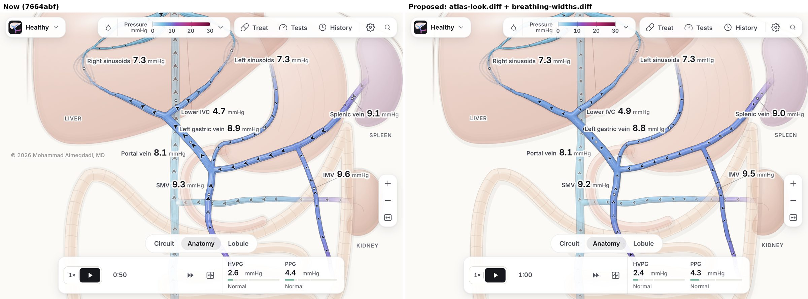

# Motion, polish and heat review: round 2

**Build tested:** `7664abf`, the head of `claude/settings-topbar-icon-flvft1`. That is the preview the developer's round-2 brief
named, with the round-2 commits `c5d7327`, `1d654ab` and `7664abf`. Round 1 (`docs/MOTION_HEAT_REVIEW.md`) was written against
`8b62ae0`. Every `file:line` below is at `7664abf`.

**What the owner asked this round:**
- Look again for animation and visualisation problems, especially the chevrons, the moving blood and the vessels: smoothness
  and transitions.
- Find better ways to get a medical-atlas look.
- Find more performance gains anywhere.
- Don't take the developer's view as settled.

---

## How this round was done

- **Same build, run locally.** The sandbox cannot open `github.io`, so `7664abf` was built and served locally, alongside
  round 1's `8b62ae0` for before/after measurement.
- **Nineteen review agents.** Six specialist audits:
  1. the new width fast path;
  2. the round-2 pop fixes;
  3. blood and chevron motion;
  4. the atlas look;
  5. performance;
  6. a pop hunt in flows round 1 didn't touch.

  Each audit was re-checked by an adversarial verifier whose job was to refute it. A completeness critic then sent out three
  follow-ups: the model-frame task, the breathing-width pipeline, and settling the atlas prototypes. Each follow-up was
  verified too.
- **Result:** 87 findings. 85 were confirmed, 1 was refuted (PE6, a shader early-out that never fires), and 1 stayed
  uncertain (AL10, part of which a follow-up later reproduced). Verifier corrections are folded into the text below.
- **My own checks.** I re-checked the headline claims in the code. I also built three patches from the agents' prototypes,
  correcting them where the verifiers found faults. Each passes lint and all 837 unit tests, alone and together, and renders
  correctly in the browser.
- **Limits.** The sandbox has no GPU and no Safari. Timings are relative costs on a 4-core VM with WebGL drawn on the CPU.
  Anything about Safari, heat or real frame rates still needs the owner's Mac, iPad and iPhone; the device list is in §6.

**A lesson from building the patches.** My first version of the width patch drew no vessels at all: a reordering left a
width as `NaN`. All 837 unit tests still passed, because the stage's tests match source text and do not run it. Only a
rendered frame caught it. The developer's brief says fixes ship "written and unit-tested, not measured or seen". For the
figure, that is not enough. §7 proposes two small browser checks that would have caught this.

---

## The short version

### What the round-2 commits got right
- **The width fast path (H1):** the stage's per-frame script time roughly halved: 71.9 → 36.6 ms/s on cirrhosis and
  92.2 → 51.8 on healthy. More than 400 frozen-clock comparisons found no visible difference on the GPU path.
- **Pop fixes:** the exit curve, dialog exits, the History card exit, the theme crossfade and the talk exit all work as
  described in Chromium.
- **`swapFade`:** never loses a swap.

### What is wrong, still open, or missed (ranked)

| # | Finding | Why it matters | In a patch? |
|---|---------|----------------|-------------|
| 1 | **Paused heat bug (FP1):** two lens switches while paused leave the figure redrawing the whole vessel layer at ~60 fps forever, in the old lens's colours. Present since round 1. | Heat with nothing moving, plus wrong colours | ✅ quick-fixes |
| 2 | **Stagnant-blood "smoke" races back and forth (BM1).** Its drift is `stasis × clock × 0.06` (`veins-gl.js:920`), so any change in stasis jumps the pattern further the longer the app has run. | The most visible blood glitch in cirrhosis | ❌ (S–M, below) |
| 3 | **Chevrons and streaks pop on or off at slow flow.** The shown speed jumps from 0 to 4.75 when flow crosses 0.25 cm/s (`blood.js:20`), so the chevron fade can't help. | Pops in reversing or slow veins | ✅ quick-fixes |
| 4 | **Every blood switch is a hard cut (NP2, BM6, NP4):** the Chevrons and Streaks toggles, the HVPG catheter (every chevron vanishes for the whole procedure), the Origin lens, the congestion halo, a TIPS or collateral drawing on (no blood for 900 ms, then full blood and stent struts in one frame). | Many pops right on the figure | ❌ (M) |
| 5 | **Breathing widths move in bursts (BM4):** the cava stands still 65–77% of the time, then lurches. It keeps only 50–80% of the breath and lags 0.5–0.7 s. | The figure's breathing isn't smooth | ✅ breathing-widths |
| 6 | **A patient change, time jump, Undo, Compare or Z recolours every vessel in one frame (NP1)** and jumps the spleen (×1.64) and the caput skin, while the liver and ascites ease. | A large half-eased, half-snapped jump | ❌ (M) |
| 7 | **Talks start janky (G1-3):** for 20–35 s after a talk starts or the patient changes, vessel geometry is re-binned 9–20×/s at 13–21 ms each (`Math.hypot`). The model-frame task peaks at 33–177 ms. | Visible stutter in every talk's first seconds | ❌ (S, below) |
| 8 | **Atlas look:** heavy black chevrons up to 86% of the lumen, flat ribbon tubes, a pale disc where the renal vein meets the cava, a cyan hover halo, organ halos instead of shadows. | The owner's atlas goal | ✅ atlas-look (needs approval) |
| 9 | **Theme crossfade swallows taps (RF1):** every tap in its 0.45 s is lost and closes Settings. Starting a talk while one is ending leaves the figure dimmed at 22% and switches the patient (RF5). | Real bugs in round-2 fixes | ❌ (S) |
| 10 | **The H5 dismissal was partly wrong (G1-1).** With the Tests dock on "Over time" the model-frame task is 7–11 ms median (p90 10–15, max 17–28); the trace is drawn twice per model frame. The chart glide also crashes on its first frame (`shown is not a function`). | Long tasks; the chart only moves at 10 Hz | ✅ quick-fixes (double draw, crash) |

### Three patches ready to try (`docs/review-round2/`, all apply to `7664abf`)

| Patch | What it does | Look changes? | Checked |
|-------|--------------|---------------|---------|
| `quick-fixes.diff` | FP1 lens heat bug; the chart glide crash; the Over-time double draw; `swapFade` no longer jumps to full mid-fade; slow-flow speed ramps from 0 (no chevron pops); the figure's labels fade before the catheter hides them; the empty box in the shunt hint | Only removes pops | Lint, 837/837. Browser: the paused lens bug goes from 60.3 to 0 redraws/s; the chart error is gone |
| `breathing-widths.diff` | Widths follow the model continuously: an exact two-stage follower, identical at 60 and 120 Hz, redrawn only once an edge moves 0.1 canvas px; a radius-only sync for the width step; the liver ease's clock | Yes: the cava breathes smoothly; the owner should look at zoom | Lint, 837/837, renders. Measured: width step 0.62–0.94 → 0.26–0.42 ms; breath kept 86–88% (was 51–57%) |
| `atlas-look.diff` | Size-capped chevrons with a dark core; lit-cylinder tubes; the renal and hepatic junction fixes; slimmer hover and selection glow; a directional organ shadow; softer streak ink; chevron radius interpolation with an early exit | Yes: needs the owner's approval | Lint, 837/837 (one source-text test updated), renders. See `compare-*.jpg` |

Apply with `git apply docs/review-round2/<name>.diff && npm run stamp && npm run lint && npm test`, then push to a preview branch
as `AGENTS.md` describes. Run the "Visual references" workflow after the two that change the look.

---

## 1. Answers to the developer's six questions

**Q1. Measure H1.**
- **Time:** the stage's rAF time per second fell 49% on cirrhosis (71.9 → 36.6 ms/s, 1.20 → 0.61 ms per frame) and 44% on
  healthy (phone @3, three 10 s windows each).
- **Correction:** the stage's *total* main-thread time fell only about 18% (86.8 → 71.0 ms/s, CPU profile). The ten-a-second
  model-frame full updates are unchanged and are now the largest stage cost.
- **Look:** no differences. A full update forced right after more than 400 width steps changed no DOM attribute and no GPU
  row. The cases covered cirrhosis, healthy, TIPS, IVC selected, the flow lens, the circuit view and SVG-only.
- **Camera moves:** pans and zooms correctly fall back to the full update on every frame.
- **Remaining cost:** the vessel sync is still 70–80% of each width step (fixed in `breathing-widths.diff`).

**Q2. Inputs the fast path misses.** Two:
- **`lvAt` (FP2).** The width step doesn't advance the liver ease's clock, so a liver ease after a cirrhosis change opens
  with a 16–29% jump in one frame (it was 4–8%). Fixed in `breathing-widths.diff`.
  - **Pre-existing, not fixed:** when paused, idle or with widths at rest, the first frame of a liver ease takes 22% of the
    change in round 1 too. Fix: start an ease from rest with one display frame's dt (`stage.js:4188`, `:4194`).
- **SVG ripple.** In SVG-only mode (no WebGL2, or the context lost), the ascites meniscus ripple is written only by the
  full update (`stage.js:4291`), so it now steps at the model's 10 Hz. Measured: 34.8 rewrites/s before, 10.2 after. Fix:
  rewrite it in `stepFluid` every frame when the SVG copy shows.
- **Test gap:** `tests/width-step.test.js` only matches source text. It still passes with every guard removed (FP4).

**Q3. Safari View Transitions (P1).**
- **Chromium:** the old snapshot captures the WebGL figure and the glass correctly.
- **Safari risk:** `sinusoid-gl.js:488` is the one canvas without `preserveDrawingBuffer`. Test the theme switch in the
  sinusoid view on a device.
- **A still:** `applyTheme` takes about 40 ms inside the callback (VM), so the old frame shows as a still for about 100 ms,
  blood frozen in it.
- **Real bug (RF1).** Every tap during the crossfade lands on `<html>`: it is lost, and it closes Settings as an outside tap.
  Pressing Dark then Soft quickly never applies Soft.
  - **Fix:** keep the transition object. On a tap during it, `skipTransition()` and re-dispatch to `elementFromPoint`.
  - **Placement matters:** the listener must be a **window** capture listener. `util.js:269` arms the popover's outside-tap
    close at window capture, which runs before any document listener (verifier, measured).

**Q4. Leaving a talk (P2).**
- **The fade:** no frame shows the chrome at full opacity before it fades in. Keys are ignored during the fade, and Esc
  twice is safe.
- **The hand-off:** there is one frame where neither the cards nor the chrome shows. A long task follows (156 ms desktop,
  298 ms iPad on the VM, mostly `rasterPlate`'s `getImageData`); on a device it is likely shorter.
- **"Starting another talk ends the old one at once" is false (RF5).** Esc, then a new talk within 200 ms: the old talk's
  restore runs under the new one. The figure stays at opacity .22 for 6–12 s, and the patient switches to Healthy mid-talk.
  - **Fix:** in `start()`, clear `leaving` before the first await, and give `putHealthy` a generation token.
  - **Abort path:** clear only the opacity and keep its transition, so the figure eases back (`presenter.js:3669`, `:3703`,
    `:3742`).
- **Reduce Motion (RF9):** the exit is still a hard cut, because `stop()` and `chromeIn` check `reduce.matches`, although
  both are opacity-only. The brief's claim that the batch-2 fades play under Reduce Motion is wrong for P2. It is also
  wrong for P9, a CSS transition that the blanket rule makes instant.

**Q5. `swapFade`.**
- **Never loses a swap:** the final content always matches the last call.
- **RF3, a jump mid-fade:** a new swap started during the previous fade-in jumped to full opacity for a frame. Holding L
  did it every 150 ms. Fixed in `quick-fixes.diff`: the fade-out starts from the current opacity and cancels the stale
  fade-in.
- **Still open, width snaps in the bars:**
  - Entering or leaving the lobule, the play bar's glass snaps 16–41 px in width as the readings swap. Play, clock and
    Compare jump 15–20 px sideways (RF4).
  - The lens key does the same to the top bar: `#btnLayers` changes 249 → 238 → 274 px, and the Blood chip jumps 11–36 px
    on every L.
  - **Fix:** reserve the wider group's width, or FLIP the bar's width with a `ResizeObserver` for the fade-in's 180 ms. A
    single FLIP inside `fill()` misses the second resize step.
- **Legend blink (NP8):** turning Compare on or off fades an unchanged legend out and in, because `renderLegend`'s key is
  too broad (`main.js:592`).

**Q6. New pops.** See §2 (the figure) and §5 (the UI).

### Where the brief was wrong or incomplete
- **H5 "already handled."** Only the hidden-chart sub-point was. With the Tests dock open, or after a patient change or
  talk start, the model-frame task is long (G1-1).
  - **Measured:** deferring the panes, H5's own remedy, saves nothing, because the forced restyle moves with them.
  - **What helps instead:** removing the waste (§4: P3, P4, P5).
- **P6 "a second vessel's contents fade in."** The desktop card does not glide at all:
  `.action-card:not(.docked) { transition: opacity .25s }` (`app.css:3211`) overrides the left/top glide at `app.css:970`.
  The card jumps 23 px between the portal and splenic veins. The old words also vanish in one frame before the new ones fade
  in (RF7).
- **P7 "glides aside (`right .3s`)."** It does glide, but `right` is a layout property, animated on the main thread. In the
  circuit view, opening Treat makes the whole map dip 17 px and then rise 44 px, because the second refit reads the pill
  mid-glide (RF2). Use `transform: translateX(...)` with the same timing.
- **Agreed with the brief:**
  - not pausing the figure under the 38% scrim;
  - not creating WebGL contexts lazily (it brings back the shader-compile hitch);
  - not easing widths on the GPU. The breathing follow-up measured that it costs more than the CPU follower, because the
    g-buffer bakes in the radius.

---

## 2. Chevrons, moving blood and vessels: motion

Checked and sound:
- **Rate independence:** speeds follow elapsed time, nothing assumes 60 Hz, and nothing strobes at 60 or 120 Hz (the worst
  case is about 12% of a shimmer cell per frame).
- **Camera:** the blood stays locked to the vessels through pans and pinches.
- **Chevron behaviour:**
  - spacing doubles by fading every other head;
  - heads flip direction only while invisible;
  - the reversed orange eases in (τ 0.5 s);
  - overlaps at joins are handled.
- **Other transitions:** Pressure → Flow widths glide (about 1.4 s), paracentesis drains (about 4 s), and the dye moves
  continuously.
- **Stale comment only:** `flowA` "fades while the view moves", but it is always 1 in the anatomy. It is still used by the
  lobule's dive (`lobule-zoom.js:2246`), so keep the uniform.

What still steps, pops or races, ranked:

**B1 · Smoke races, worse the longer the app runs** (BM1, high, measured)
- **Where:** `veins-gl.js:920`: `float drift = stasis * clock * 0.06;`. `clock` is the blood clock since load, so any
  change in a vessel's stasis shifts its whole smoke pattern by Δstasis × clock × 0.06 cells. In cirrhosis, the right
  portal branch and a reversed IMV swing stasis with the breath, so their smoke lurches back and forth.
- **Fix:**
  - **Integrate per stream on the CPU:** in `advanceStream`, `st.drift = ((st.drift || 0) + st.stasis * dt * 0.06) % 50`.
    50 cells is the noise period, so the wrap is seamless. Also do it in the settle branch, which returns early at
    `blood.js:93`.
  - **Send it** in flow texel 3 `.z` and read it in the shader instead of line 920.
  - **The lobule** draws with the same shader. It must integrate and write its own drift (`lobule-zoom.js:1551`, `2228`,
    `2231`), or its stagnant-sinusoid smoke will stop drifting.

**B2 · Slow flow pops the chevrons and streaks on and off** (verifier finding, code; fixed in `quick-fixes.diff`)
- **Where:** `blood.js:20` returned 0 below 0.25 cm/s and 9.5·√v above, a jump from 0 to 4.75. The chevron fade
  `smoothstep(0.5, 3.0, |vd|)` (`veins-gl.js:985`) cannot ease a jump that skips its whole range.
- **Fix:** the patch ramps the shown speed from 0 between 0.25 and 0.6 cm/s, so heads and streaks fade in with the flow. The
  4×-is-2× speed scale above 0.6 is unchanged; `tests/blood.test.js` passes.

**B3 · Reversal flaps with every breath near the cut-off** (BM2, medium, measured)
- **What:** with deeper breathing, the IMV's flow swung across −0.12 mL/s and its reversed state flipped 5 times in 7 s. Each
  flip replays the 0.6 s settle, 0.6 s stand and 0.5 s ramp. In the Direction lens the lumen flips blue ↔ orange in one
  frame each time.
- **Fix:**
  - **Decide on breath-averaged flow.** Respiration is a fixed 4 s sine (`engine.js:291`), or require a state to hold for
    one breath. A simple hysteresis band does not stop it, because Qf crosses both thresholds.
  - **Lens colour:** drive the Direction lens from the already eased `sm.rev`, through a colour-only sync.
  - **Cache** the reversed flags per model frame (see §4, P8).

**B4 · Every blood switch is a hard cut** (NP2, BM6, NP4, high, measured: the uniforms flip in one frame)
- **The cuts:**
  - **Toggles:** Chevrons and Streaks.
  - **HVPG catheter:** every chevron vanishes 0.4 s after the procedure starts and returns in one frame at its end
    (`chevOn() && !cath.st`).
  - **Lenses and halos:** the Blood origin lens and the congestion halo.
  - **Vessels drawing on or retracting:** a TIPS draws on for 900 ms with no blood, then the streaks, chevrons and stent
    struts appear in one frame (933 ms). Removing it, the blood and struts go before the tube retracts.
  - **Strands and tributaries:** their blood switches at half opacity (`live >= 0.5`, `stage.js:7125-7130`).
  - **Free-end flags:** they flip the end fade in one frame.
- **Fix:**
  - **Global fades:** eased floats `streakA`, `chevA` and `originA` (τ ≈ 0.12–0.15 s) in `stepBlood`, multiplied in the
    shader, with the loop kept awake while any is between 0 and 1. The lobule passes one alpha for both, so `chevA` must
    default to it there.
  - **Per-vessel fades:** use flow texel 1 `.z` as an eased strength. It follows the reveal progress (`easeInOut(u)` in,
    `1 − easeInOut(u)` out) and `sd.live` for strands, instead of the 0.5 gate.
  - **Stent mesh and ligature:** draw them during the reveal, dashed by the same `pathLength` offset.

**B5 · Breathing widths move in bursts** (BM4 and the breathing follow-up, measured; `breathing-widths.diff`)
- **Today:** widths re-target only after moving 0.5 px, then ease with τ 0.25 s. Replaying recorded samples, the drawn IVC,
  RHV and MHV stand still 65%, 77% and 74% of the time. They keep 80%, 50% and 52% of the breath, lag 0.53–0.74 s, and step
  up to 0.8 px a frame in the browser.
- **The patch:** drops the dead band and follows the model with two equal lags in series (τ 0.2 s). Each step uses the exact
  solution, and it advances to a model frame's arrival before taking that frame's target. Verified on a breathing target:
  60 Hz and 120 Hz agree to 1e-14 (the prototype's order differed by 1e-2).
  - **Redraws** happen only once an edge moves 0.1 canvas px, and exactly at rest.
  - **The width step** syncs only the radii (with the ligated-vein texel).
- **Measured on the prototype:**
  - 0% standing still; 86–88% of the breath kept; steps ≤0.13 px;
  - less pulse wobble than today;
  - width step 0.62–0.94 → 0.26–0.42 ms;
  - redrawn GPU area 10–25% of the composite at 4× zoom, against 5–9% today. Without the 0.1 px gate it was 43–57%; that
    variant was rejected.
- **Owner check:** the dead band also hid small pulse and breath wobble in the other veins, so at high zoom more veins move
  very slightly. Look at it on the iPad before it ships.

**B6 · Model jumps snap half the figure** (NP1, high, measured)
- **What:** Healthy → decompensated cirrhosis in one frame: the portal vein goes rgb(113,155,222) → rgb(166,37,102), the
  spleen scales 1.00 → 1.64, and the abdominal-wall (caput) skin goes from opacity 0 to 0.90. Meanwhile the liver eases over
  about 3 s and the ascites over about 5 s. The same happens on time jumps, Undo/History, Compare Then/Now and Z.
- **Fix:**
  - **Colours:** run the existing 300 ms lens crossfade on any discontinuity, keyed on preset, compare view, mode and a
    "jump" counter that `main.js` bumps on restore, settle, advance and preset.
  - **Spleen and caput:** ease them like the liver.

**B7 · Vessel colours step in 0.5 mmHg bins and flicker with the breath** (BM7, low, measured)
- **What:** vessels near a bin edge alternate bins with each breath (splenic vein 142/26/83 ↔ 146/28/86). During a treatment
  the colours walk in stairs at up to 10 Hz.
- **Fix:** add hysteresis on the bin, then a 0.25 s colour ease through a colour-only sync like `syncGlowOnly` (the full
  sync is 0.44 ms a call).

**B8 · Label keep-out boxes slice arrowheads** (BM3, NP15, medium, seen in captured frames on iPhone)
- **What:** IVC heads under "Right hepatic vein" are cut along a straight, unantialiased edge. In talks the box count changed
  0 → 1 → 0 → 2 in single frames. The boxes are taken before `labelGlide`, so they jump ahead of a gliding label.
- **Fix:**
  - **Quick:** take the boxes after the glide, and give `noChev` the same `smoothstep(−pxW, pxW)` edge that `chevHole` has.
  - **Full:** fade whole heads by arc-length intervals per vessel (two per row, in a fifth flow texel).

**B9 · The lobule dive freezes the anatomy** (NP13, medium, code)
- **What:** during the dive and the rise, `animate()` returns before drawing (`stage.js:7191`), so streaks, chevrons and
  breathing stop for the ~0.6 s the anatomy is still visible each way. That conflicts with "never freeze the physiology".
- **Fix:** keep the plate frozen, but run `stepBlood` and `veins.composite` each frame while the anatomy is visible. No
  `update()` or `refreshCTM`: the box measured under the scale is wrong.

**B10 · Fades stop mid-way while paused** (NP7, medium, measured)
- **What:** "Key chevrons only" and the reversed orange freeze at 46–85% when paused, until Play.
- **Fix:** a `bloodEasing` flag in `stepBlood` (snap within 0.002), added to the sleep test at `stage.js:7220` as
  `widthEasing` is.

**B11 · Smaller items**
- **Bleed jets and the ascites ripple jump on pause and play** (BM8). Feed `bloodClock`, not `performance.now()`, to
  `bleedShapes`, and integrate the ripple phase by dt.
- **Shimmer density jumps when the whole-number lane count changes** on zoom, along a taper, or with the breath (BM9). Use a
  continuous `sumK` in the shader and in the lobule's JS copy (`lobule-zoom.js:2201-2205`).
- **Chevron size and fade step at the 64 radius samples** (AL3).
  - **Chevrons:** fixed in `atlas-look.diff` with `radAt`, which interpolates as `bloodAt` does, plus a safe early exit.
  - **Dye front:** `dyeAt` (`veins-gl.js:995`) has the same seam.
- **Narrowing, clot and banding snap** on discrete changes (NP5, NP6). Ease shown values (`stS`, `thS`, a shown band count).
  Pass the strand's `live` as its blood strength.
- **Phasic speed (off by default) is a 10 Hz staircase** (BM10). If it is ever offered, lerp `vNow` between the last two
  model frames (a one-interval render delay).

---

## 3. The atlas look

`docs/DESIGN_BLUEPRINT.md` §5.1 asks for "a simplified Netter, rendered flat with subtle depth". The proposals below push the
"subtle depth" further, so the owner decides. Everything in `atlas-look.diff` runs in the cached vessel pass, or costs a few
texture reads on chevron pixels, so per frame it is essentially free and changes no rate.

| Image | Shows |
|-------|-------|
| `review-round2/compare-fork.jpg` | Portal fork, zoomed |
| `compare-hover.jpg` | Hover on the right hepatic vein |
| `compare-renal.jpg` | Renal–cava junction |
| `compare-cirr.jpg` | Decompensated cirrhosis |
| `compare-cirr-dark.jpg` | Dark theme |

Left is `7664abf`, right is all three patches.

**A1 · Chevrons** (AL2, the atlas settle follow-up)
- **Today:**
  - every head is `#14141A` near-black, up to 0.86 of the lumen radius;
  - zoomed in, the portal vein carries wedges about 40 px across that outweigh the vessel;
  - on the faded cava the same black reads as brown-grey "A" shapes;
  - at forks, part-faded heads look like grey ghosts.
- **In the patch:**
  - **Size:** a half-width of 4–8 CSS px, never over 0.8 of the lumen, through a new `cssPx` uniform (the vessel canvas is
    at most 2×).
  - **Ink:** the dark core is kept, with at most a 20% tint toward a deep shade of the vessel's own colour. The full
    tone-on-tone I first suggested was measured and **rejected**: contrast fell from 5.8 to 4.5 on the portal vein, and from
    2.9 to 2.1 on the faded cava.

**A2 · Tubes as a lit cylinder** (AL4, settle follow-up G3-4)
- **Today:** a flat ribbon with two hairlines, a uniform dark casing on both sides, and a 6% contact shadow nobody can see.
- **In the patch:**
  - one key light (upper left): diffuse falloff across the tube;
  - a specular highlight corrected to be zero on the axis, so the axis keeps the exact lens colour (median error
    0.4/255);
  - the mean lumen comes out about 4% darker.

**A3 · Junction bugs** (AL1, G3-1, G3-2, measured)
- **What:** a pale disc (+30/255) where the left renal vein meets the cava, and a fog where the hepatic veins join it.
- **Cause:** a cross-tier copy faded to 0 and capped again by the joining vein's fade.
- **In the patch:** the renal vein fades only to the cava's veil level, the hepatic veins to 0.5, and the copy is drawn
  uncapped. The disc goes from +30 to 2.7/255.
- **Test before shipping:** a *back* vessel selected (SVC_RA, V_KID_L). There the copy's alpha can exceed 1 at a join
  (verifier, untested).

**A4 · Hover and selection** (AL5)
- **Today:** hover lays a saturated halo about 25 px wide in the vessel's own colour.
- **In the patch:** a slim band (`wide` 0.5) for hover and 0.6 for selection, which has its own ring.
- **Separate perf bug:** each hover in and out redraws the whole vessel layer twice (1,044 cells against 69). When the
  plate raster lands (`stage.js:3373`), `tubesLook` isn't refreshed, so the next sync redraws everything again
  (`stage.js:3155`).

**A5 · Organ shadows** (AL8)
- **Today:** `.org-ao` is a 9-unit stroke centred on each outline, so every organ wears a symmetric grey halo.
- **In the patch:** offset by `translate(2.5 4)`, so the shadow falls lower right, consistent with the light.

**A6 · Streak ink** (AL9)
- **Today:** white hairline streaks on dark lumens (from about 7–8 mmHg up) read as scratches or brushed metal.
- **In the patch:** a softer core and halo. Lanes, speeds and the clock are untouched, so the motion is identical.

**A7 · The pressure ramp is flat where it matters** (AL7, not in a patch)
- **What:** OKLab lightness is 0.556 at 12 mmHg and 0.553 at 20. The range the app teaches most changes only hue, so a
  projector or a printed handout can't tell 12 from 20. `docs/ACCESSIBILITY.md` and `colormap.js` call the scale
  "perceptually uniform".
- **Proposal:** `--ramp-pressure: #DBEAF8 0, #99C2ED 5, #718EDF 10, #8671CF 12, #9B2B6A 20, #661030 30;`. Lightness falls
  monotonically, with atlas hues (sky, cornflower, cobalt, violet, carmine, wine). It also lowers chroma about 20% at 12 and
  20, a more muted carmine the owner should judge.
- **If adopted:** re-match the trace inks that copy the plate hues, and redraw the visual references.

**A8 · Other things seen**
- **Cirrhotic nodules** read as a flat honeycomb. A bevel (two offset copies of the nodule path) would help, but that path is
  a 290 KB string rebuilt during liver eases. Coordinate with the organ thread.
- **The Soft theme's ascites** is a mustard slab.
- **The C7 strands** end in round caps inside the cava's lumen. That needs a structural fix: end them at the wall.
- **Sinusoid wisps without casing (AL6)** leave square notches at the joins. Low value; not in the patch.
- **Labels under the view switcher (G3-7, reproduced).** Reading labels can sit under the Circuit/Anatomy/Lobule switcher.
  Add `#nbViews` to the blockers list (`stage.js:5905`). Do not add the `.stage-blocker` class: the credit and pan starts
  read it.
- **The vessel canvas is capped at 2×** (`stage.js:1980`), so on a 3× iPhone the figure is drawn at 2/3 of native
  resolution. Not a recommendation (2.25× the fragment work), but it bears on "zero quality drop", so the owner should know.

---

## 4. Performance: new gains

All of these keep the same pixels and the same continuous motion.

| # | Gain | Measured (VM, relative) | Where |
|---|------|------------------------|-------|
| P1 | Radius-only sync in the width step | Width step 0.62–0.94 → 0.26–0.42 ms; stage script −15–40%; whole syncs 37–66/s → 10/s | ✅ `breathing-widths.diff` |
| P2 | Paused lens switch redraws forever | 60.3 → 0 vessel draws/s while paused | ✅ `quick-fixes.diff` |
| P3 | `binVeins` re-bins on every coil step after a patient change or talk start | 9–20 re-bins/s for 20–35 s at 13–21 ms each (160–270 ms/s). Squared distances instead of `Math.hypot` in `veins-bin.js:121`, `:130` and `segDist` (`:9-13`) give identical output, 1.7–3× faster. Later: persistent buffers so a coiling collateral redraws only its own cells | `veins-bin.js` |
| P4 | Over-time trace drawn twice per model frame | Task 9.8 → 7.1 ms | ✅ `quick-fixes.diff` |
| P5 | Forced restyles in the model-frame task with the Tests dock open | 4–5 ms each, from `workspace.offsetParent` (`dock.js:470`) and canvas font sets (`pressure-time.js:526`, `charts.js:109`). Draw before `updateHero`, set the font once | `dock.js`, `pressure-time.js` |
| P6 | `syncVeinsNow` churns 1–3 MB/s of garbage | −29–35% per call, −26–47% allocation. `Float32Array.some` → index loop (`:3139`), `arcLen` once per feeder (`:3122`), no `Math.max(...R)`, element-wise radius compare instead of `R.join(',')`. Key the look on its inputs, not a counter | `stage.js` |
| P7 | Label and clock `textContent` writes restyle ~85 elements per model frame through `:has()` in the phone/iPad layout | Style recalc 31.5 → 3.7 ms/s (Chromium). Use the in-place `Text.data` helper already in `dock.js:24` at `stage.js:5606`, `timeline.js:275`, `main.js:385`, `dock.js:251`. WebKit unmeasured | four sites |
| P8 | `stepBlood` recomputes per-model-frame facts every display frame | 10.5 ms/s at 60 fps, doubles at 120. Cache the reversed flags, velocities and key-chevron targets per F; version `syncEnds`; reuse one `bloodLook` object; snap `chevK` at the end of its fade (rows linger ~50 s doing full chevron work); set unchanged uniforms only on change | `stage.js:7083-7175` |
| P9 | An ascites ease repaints the whole canvas every frame for ~2 s | Scissor the full quad to `fluidRect`, with an explicit fluid-only argument (whole redraws also use `full`) | `veins-gl.js:1810` |
| P10 | The composite shader is compiled four times (twice per context, two contexts); compiles are waited on synchronously | The lobule prewarm compile was a 2.4–3.6 s task on the VM. Share one shader object per context; use `KHR_parallel_shader_compile` where available | `veins-gl.js:1171`, `:1201` |
| P11 | After a patient change, `prepLobule` runs about 8 main-thread pieces while the blood moves | Pieces of 65–347 ms on the VM; likely hitches on a phone | `stage.js:2168-2183` |
| P12 | With a TIPS or DIPS shown, every width step runs `updateLabels` | 4.7 ms/s at 60 Hz (doubles at 120) | `stage.js:2506` |
| P13 | The open Doppler card's marker transitions `left`, which keeps the layout watch due, so width steps fall back 3–6×/s | Ignore motion more than one level below a placed piece in `layoutWatch`'s `onMotion` (the credit reads direct children) | `doppler.js:363`, `idle-keys.js:84` |
| P14 | Chart glide crash: the glide runs only at 10 Hz | `charts.js:74` shadows `shown()` | ✅ `quick-fixes.diff` |

**Checked and not worth it (measured):**
- scissoring the composite to the viewport;
- skipping the flow upload;
- the worker payload (9.8 frames/s, typed arrays transferred);
- detaching the hidden SVG;
- class-toggle style cost;
- deferring the panes (H5's remedy).

**Startup.**
- 8.3 MB of the 12 MB `dist` is WebP deck and handout images, loaded on use and not precached. The precache is about
  2.9 MB.
- The comment at `scripts/build.mjs:95` still says "4 MB or so".

---

## 5. Pops and glitches in the interface

- **RF1:** theme crossfade swallows taps (§1, Q3).
- **RF2:** the circuit map dips and rises when a card opens, because the zoom pill animates `right` (§1).
- **RF4 and the lens key:** the play bar and the top bar snap in width on swaps (§1, Q5).
- **RF5:** a talk restarted while one is ending stays dimmed (§1, Q4).
- **RF7:** the desktop vessel card jumps 23 px and blinks its words on a new vessel. The play icon is empty for a frame,
  because the old one is removed before the new one grows from .6. Stack both icons and crossfade them.
- **RF8:** a Tests pane left `.landed` skips its entrance the next time. Clear `.landed` when a pane loses `.active`
  (`dock.js` `layout()`).
- **NP3:** Add shunt on the GPU figure shows no glowing targets before hover, and none at all on touch, though the hint says
  "Click a glowing vein". Drive it through `setGlowSrc` and the network fade.
- **NP9:** the Compare "Showing 0:48" badge sits hidden under the top bar's centre pill on desktop.
- **NP10:** all figure labels vanish in one frame when the catheter starts (✅ `quick-fixes.diff`).
- **NP11:** closing cards are cut short by fixed timers while their fade still plays. Hide on `animationend` or
  `getAnimations()[0].finished` with a backstop.
- **NP12:** the zoom pill jumps when Rotate appears in the circuit view and in the sinusoid view. On the phone it pops via
  `display: none`.
- **NP14:** the "Make a shunt" hint shows an empty bordered box, from a generic `.sp` card rule (✅ `quick-fixes.diff`).
- **NP16:** an iPad rotation lands in an interim framing, then zooms again about 0.4 s later. Set the home framing inside the
  resize callback when the view is at home.
- **Over-time y-axis rescales in one frame** (`pressure-time.js:214-220`). Ease the lane's `[lo, hi]`.

Round-1 items that are still open:
- P3: the reduced-motion blanket rule;
- P13: the tap half of the Tests tab crossfade;
- P15–P23: lobule labels, nav pill rebuild, lists, toasts, the palette and Why? closes, circuit dots, scrolls, the monitor
  alarm, the badge;
- V4 and V6: font weights, `dvh` and the tap highlight.

---

## 6. Still needs a device (Safari on Mac, iPad, iPhone)

1. **The theme crossfade:**
   - in the sinusoid view (its canvas has no `preserveDrawingBuffer`);
   - with glass cards open;
   - whether taps are lost there too.
2. **The talk exit:** how long the hand-off task really is, and whether the composited fade keeps running through it.
3. **Breathing widths** (after `breathing-widths.diff`), at the home view and zoomed in: smooth, no visible extra pulse.
4. **The atlas patch:** chevron legibility on the faded cava and on dark magenta veins at arm's length, the lit cylinder in
   all three themes, and the projector.
5. **P7 on WebKit:** whether the `:has()` restyle cost exists there at all.
6. **Frame rate:** read `?debug`'s number (now scaled to 120) with Safari's "Prefer Page Rendering Updates near 60fps" flag
   on and off.

---

## 7. Next steps

1. **Apply `quick-fixes.diff`.** It removes a paused heat bug and several pops, with nothing to approve.
2. **Apply `breathing-widths.diff`.** The owner checks the breathing on the iPad and iPhone.
3. **Fix the remaining blood motion:**
   - B1 (the smoke race), B4 (eased blood switches and reveals), B6 (crossfade on model jumps);
   - RF1 (taps in the theme crossfade) and RF5 (talk restart);
   - then B3, B8, B9, B10.
4. **Owner reviews `atlas-look.diff` on the preview.** Keep or drop each part: chevron size, cylinder, hover, shadow, streak
   ink. The pressure ramp (A7) is a separate decision.
5. **Performance:** P3 (`binVeins`), P6 (sync allocations), P7 (text writes), P8 (`stepBlood` caching), P10 (shader
   compiles), P11 (lobule prep slices).
6. **Guard rails.** Two browser checks would have caught this round's worst slips: my `NaN` widths, and the paused lens
   heat bug that was there since round 1.
   - **Draw check:** the figure draws vessels. Count non-paper pixels in the figure region on the GPU path, at the home view
     and zoomed.
   - **Equivalence check:** a width step and a full update agree. Freeze the clock, force a full update right after a width
     step, and assert no DOM or GPU-row difference (the H1 audit's `equiv.mjs`). Also check that a paused figure goes to
     sleep after a lens switch.

   `tests/width-step.test.js` and `tests/veins-tint.test.js` only read source text. Keep them, but don't rely on them for the
   figure.

**Decisions only the owner can make:**
- the atlas look, part by part;
- the pressure ramp;
- breathing widths moving continuously, including the slight extra motion in other veins at zoom;
- the vessel canvas's 2× cap on 3× iPhones.
